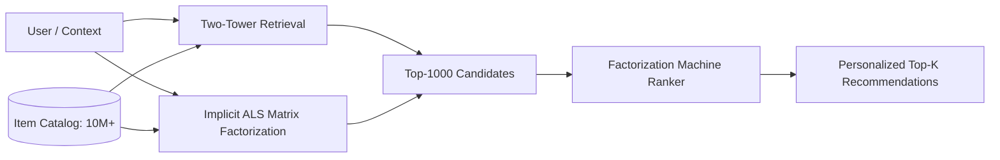

# Module 14: Recommendation Systems & Collaborative Filtering

This module covers the core architectures used in modern multi-stage recommendation systems, from massive-scale candidate retrieval to high-capacity ranking and click-through rate (CTR) prediction.

---

## Architecture Overview



---

## Directory Structure

```
14_recommender_systems/
├── 01_recommender_systems_catalog.md  # Comprehensive theoretical guide & formulations
├── README.md                          # Architecture and usage guide
├── src/
│   ├── __init__.py                    # Public API exports
│   ├── als_recommender.py             # Hu-Koren-Volinsky Implicit ALS
│   ├── two_tower.py                   # In-batch contrastive dual-encoder retrieval
│   └── factorization_machine.py       # O(kd) second-order interaction FM for CTR
└── tests/
    ├── __init__.py
    ├── test_als_recommender.py        # Matrix factorization tests
    ├── test_two_tower.py              # Normalized cosine retrieval tests
    └── test_factorization_machine.py  # Pairwise interaction ranking tests
```

---

## Quickstart Example

```python
import numpy as np
from src.als_recommender import ImplicitALS
from src.factorization_machine import FactorizationMachine

# 1. Implicit Feedback Collaborative Filtering
R = np.array([
    [5, 0, 1, 0],
    [0, 4, 3, 1],
    [3, 0, 0, 4],
])
als = ImplicitALS(n_factors=8, alpha=20.0).fit(R)
top_items = als.recommend(user_idx=0, top_k=2)
print("Recommended item indices & scores:", top_items)

# 2. Factorization Machine for CTR Ranking
X = np.random.randn(100, 10)
y = (X[:, 0] * X[:, 1] > 0).astype(int)
fm = FactorizationMachine(n_factors=4, learning_rate=0.05).fit(X, y, epochs=15)
probs = fm.predict_proba(X[:5])
print("Predicted CTR click probabilities:", probs)
```

---

## Running Verification Tests

```bash
pytest 14_recommender_systems/tests
```
